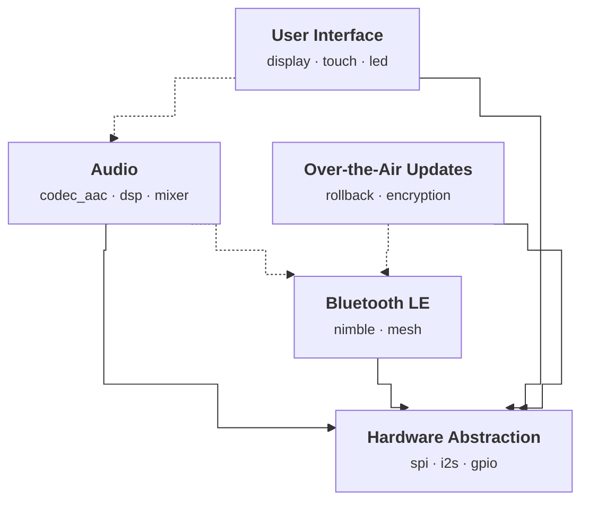

# kconfig2mermaid

Generate Mermaid module diagrams from Kconfig files. Zero annotations required.



## How it works

Point it at a directory of `.kconfig` files. Each file becomes a module. The diagram is derived entirely from standard Kconfig constructs:

1. **Modules**: each `.kconfig` file is a module. ID from the filename (`ble.kconfig` -> `BLE`), display name from the first `menu "..."` title.
2. **Hard dependencies**: `depends on` and `select` referencing a symbol that belongs to another module produce a solid arrow.
3. **Optional relationships**: `imply` referencing another module produces a dashed arrow.
4. **Components**: `choice` blocks and `config` symbols with `bool` prompts are listed inside the module box.

No custom syntax needed. Kconfig already has the information; kconfig2mermaid reads it.

## Install

```bash
pip install kconfig2mermaid
```

## Quick Start

Every `.kconfig` file becomes a module automatically:

```kconfig
menu "Bluetooth LE"
    depends on HAL

config BLE
    bool "Enable Bluetooth LE"
    select HAL_SPI
    imply AUDIO

choice
    prompt "BLE Stack"
    depends on BLE
config BLE_NIMBLE
    bool "NimBLE"
config BLE_BLUEDROID
    bool "Bluedroid"
endchoice
endmenu
```

Generate the diagram:

```bash
kc2mm generate --kconf-dir path/to/kconfig/
```

Or inject it directly into a markdown file:

```bash
kc2mm inject README.md --kconf-dir path/to/kconfig/
```

## What gets derived

| Kconfig construct | Diagram result |
|---|---|
| `depends on` / `select` across modules | Solid arrow (hard dependency) |
| `imply` across modules | Dashed arrow (optional relationship) |
| `choice` blocks | Component labels |
| `config` with `bool` prompt | Component labels |
| `menu "Title"` | Module display name |
| Filename (`ble.kconfig`) | Module ID (`BLE`) |

## Overrides

Everything is auto-derived, but you can override when needed:

| Comment | Effect |
|---|---|
| `# kc2mm:ignore` | Exclude this file from the diagram |
| `# @module ID "Name"` | Override module ID and/or display name |
| `# @module ID : a · b · c` | Override auto-derived components |
| `# @module ID -> TARGET` | Add an explicit solid arrow |
| `# @module ID --> TARGET "label"` | Add an explicit dashed arrow with label |

## CLI

```
kc2mm generate --kconf-dir DIR [-o FILE] [--direction LR] [--long-names] [--hal-module HAL]
kc2mm inject FILE --kconf-dir DIR [--check]
```

- `generate`: emit Mermaid to stdout or file
- `inject`: insert or update a `<!-- module-diagram:start -->` / `<!-- module-diagram:end -->` block in a markdown file
- `--check`: exit 1 if the diagram in the file is stale (useful in CI)
- `--long-names`: use full choice prompt text instead of short labels
- `--hal-module`: module ID to auto-add edges to (default: `HAL`, empty to disable)
- `--direction`: Mermaid flowchart direction (`TB`, `LR`, etc.)

## Example

See [examples/demo/](examples/demo/) for a complete working example with five embedded firmware modules.

## License

MIT
