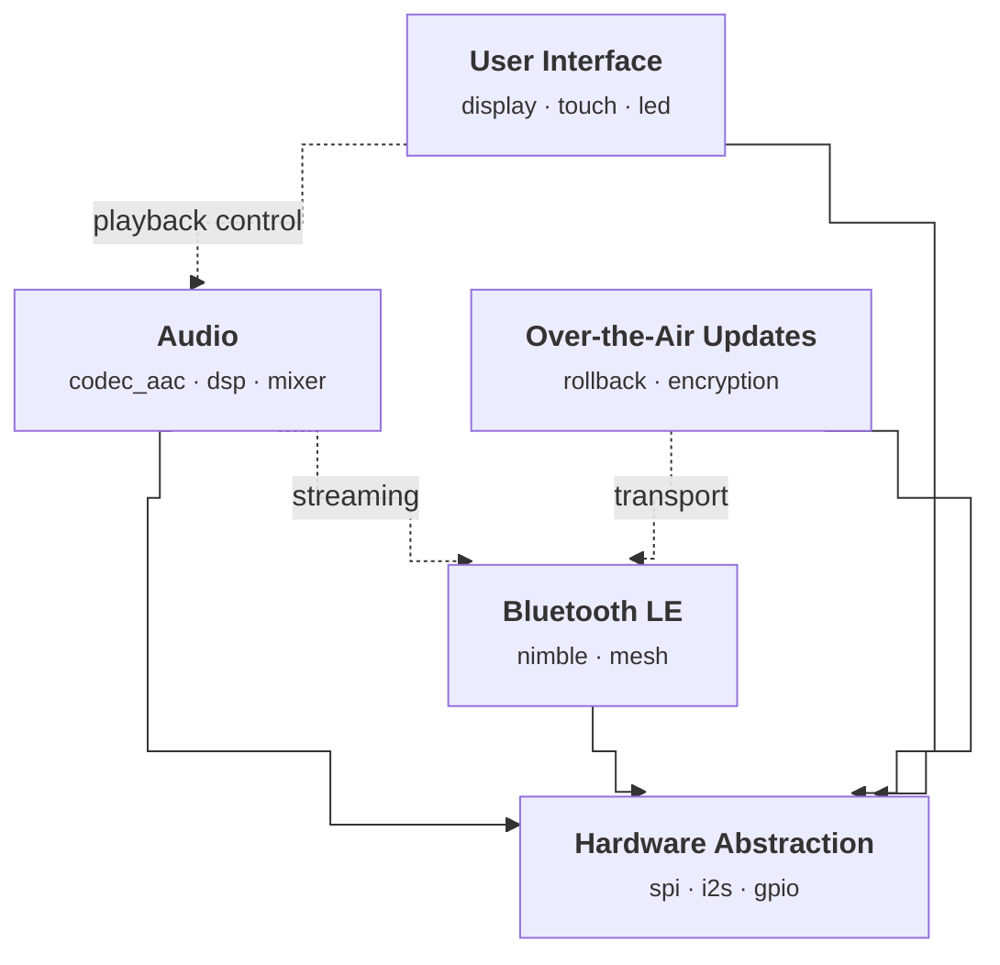

# kconfig2mermaid

Generate Mermaid module diagrams from Kconfig `@module` annotations.



## Why?

Embedded firmware projects use Kconfig for build configuration, but the module structure and dependencies live only in developers' heads. kconfig2mermaid reads lightweight comment annotations from your existing `.kconfig` files and produces a Mermaid diagram: modules with their components, hard dependencies, and optional links. The diagram stays in sync with the code because it's generated from it.

## Install

```bash
pip install kconfig2mermaid
```

## Quick Start

Add `@module` annotations to your `.kconfig` files:

```kconfig
# @module BLE "Bluetooth LE"
# @module BLE -> HAL
menu "Bluetooth LE"

choice
    prompt "BLE Stack"
config BLE_NIMBLE
    bool "NimBLE"
config BLE_BLUEDROID
    bool "Bluedroid"
endchoice
endmenu
```

Generate the diagram:

```bash
kc2mm generate --kconf-dir path/to/kconfig/
```

Or inject it directly into a markdown file:

```bash
kc2mm inject README.md --kconf-dir path/to/kconfig/
```

## Annotation Reference

| Annotation | Effect |
|---|---|
| `# @module` | Declare module (ID from filename) |
| `# @module ID` | Declare module with explicit ID |
| `# @module ID "Name"` | Declare module with display name |
| `# @module ID : a · b · c` | Explicit component list |
| `# @module ID -> TARGET` | Solid arrow (hard dependency) |
| `# @module ID --> TARGET` | Dashed arrow (optional dependency) |
| `# @module ID --> TARGET "label"` | Dashed arrow with label |

When no explicit components are given, they are auto-derived from `choice` blocks and `config` symbols with `bool` prompts.

## CLI

```
kc2mm generate --kconf-dir DIR [-o FILE] [--direction LR] [--long-names] [--hal-module HAL]
kc2mm inject FILE --kconf-dir DIR [--check]
```

- `generate`: emit Mermaid to stdout or file
- `inject`: insert or update a `<!-- module-diagram:start -->` / `<!-- module-diagram:end -->` block in a markdown file
- `--check`: exit 1 if the diagram in the file is stale (useful in CI)
- `--long-names`: use full choice prompt text instead of short labels
- `--hal-module`: module ID to auto-add edges to (default: `HAL`, empty to disable)
- `--direction`: Mermaid flowchart direction (`TB`, `LR`, etc.)

## Example

See [examples/demo/](examples/demo/) for a complete working example with five embedded firmware modules and annotated Kconfig files.

## License

MIT
