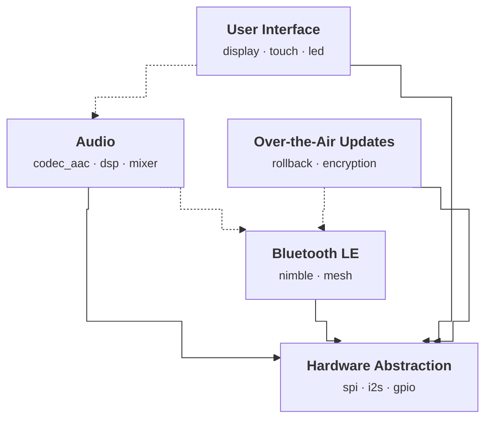

# Demo: Embedded Firmware Modules

This example models a small embedded firmware with five modules:

| Module | Description |
|--------|-------------|
| HAL | Hardware abstraction (SPI, I2S, GPIO) |
| BLE | Bluetooth LE stack with mesh support |
| Audio | Codec selection, DSP pipeline, mixer |
| UI | Display, touch, and LED indicators |
| OTA | Over-the-air updates via BLE transport |

## Generate the diagram

```bash
kc2mm generate --kconf-dir examples/demo/kconfig
```

## Output

<!-- module-diagram:start -->

<!-- module-diagram:end -->

## How it works

Every `.kconfig` file is a module by default. Everything is derived from standard Kconfig:

```kconfig
menu "Audio"
    depends on HAL

config AUDIO
    bool "Enable Audio"
    select HAL_I2S
    imply BLE

choice
    prompt "Audio Codec"
    depends on AUDIO
config AUDIO_CODEC_AAC
    bool "AAC"
config AUDIO_CODEC_SBC
    bool "SBC"
endchoice

config AUDIO_DSP
    bool "DSP pipeline"
    depends on AUDIO
endmenu
```

- Module ID from filename (`audio.kconfig` -> `AUDIO`), display name from `menu` title
- `depends on` / `select` across modules produce solid arrows (hard dependency)
- `imply` across modules produces dashed arrows (optional relationship)
- Components are auto-derived from `choice` blocks and `config` symbols with `bool` prompts
- Add `# kc2mm:ignore` to exclude a file from the diagram

## Keep it in sync

```bash
kc2mm inject --check examples/demo/DEMO.md --kconf-dir examples/demo/kconfig
```

This exits non-zero if the diagram in this file is stale, making it easy to add as a CI check.
