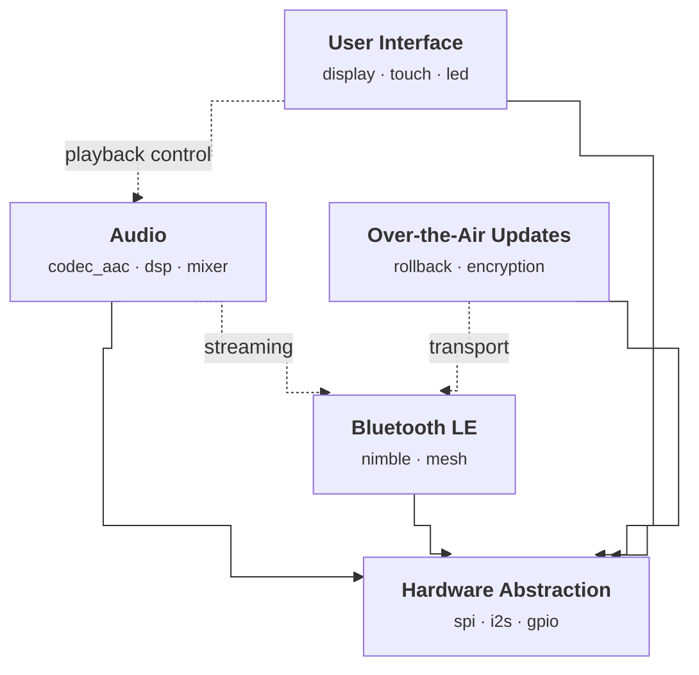

# Demo: Embedded Firmware Modules

This example models a small embedded firmware with five modules:

| Module | Description |
|--------|-------------|
| HAL | Hardware abstraction (SPI, I2S, GPIO) |
| BLE | Bluetooth LE stack with mesh support |
| Audio | Codec selection, DSP pipeline, mixer |
| UI | Display, touch, and LED indicators |
| OTA | Over-the-air updates via BLE transport |

## Generate the diagram

```bash
kc2mm generate --kconf-dir examples/demo/kconfig
```

## Output

<!-- module-diagram:start -->

<!-- module-diagram:end -->

## What the annotations look like

Each `.kconfig` file uses comment annotations to declare modules and their relationships:

```kconfig
# @module AUDIO
# @module AUDIO -> HAL
# @module AUDIO --> BLE "streaming"
menu "Audio"

choice
    prompt "Audio Codec"
config AUDIO_CODEC_AAC
    bool "AAC"
config AUDIO_CODEC_SBC
    bool "SBC"
endchoice

config AUDIO_DSP
    bool "DSP pipeline"
endmenu
```

- `# @module` declares a module (ID derived from filename, display name from `menu` title)
- `->` creates a solid arrow (hard dependency)
- `-->` creates a dashed arrow (optional dependency) with an optional label
- Components are auto-derived from `choice` blocks and `config` symbols with `bool` prompts

## Keep it in sync

```bash
kc2mm inject --check examples/demo/DEMO.md --kconf-dir examples/demo/kconfig
```

This exits non-zero if the diagram in this file is stale, making it easy to add as a CI check.
